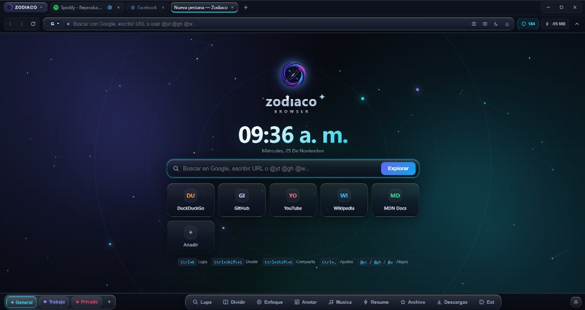
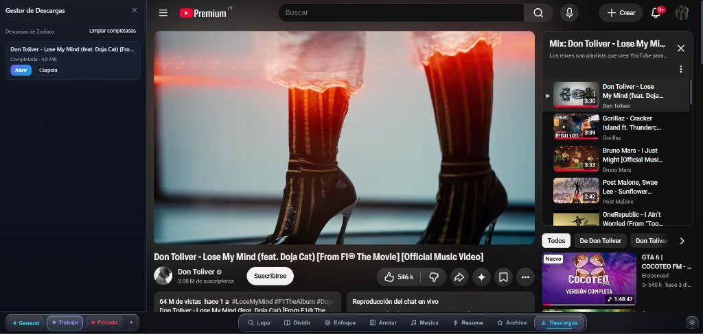
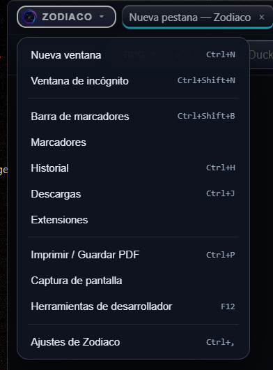

# Zodiaco Browser

**Zodiaco** es un navegador web moderno para escritorio diseñado para ofrecer **alta productividad, aislamiento real por espacios de trabajo, bajo consumo de memoria RAM y reproducción multimedia sin bloqueos** (incluyendo soporte Widevine DRM).

---

## Descarga para Windows (`.exe`)

- **Instalador directo (`v0.1.2` · Windows 10/11 64-bit):** [**Descargar `Zodiaco-Browser-Setup-0.1.2.exe`**](https://github.com/sebaslink/zodiaco-browser-releases/releases/download/v0.1.2/Zodiaco-Browser-Setup-0.1.2.exe)
- **Todas las versiones y actualizaciones:** [**GitHub Releases (última versión)**](https://github.com/sebaslink/zodiaco-browser-releases/releases/latest)

> **Incluye:** soporte **Widevine DRM** listo para usar (Spotify Web y streaming) y **actualizaciones automáticas** integradas (en modo automático o manual desde el menú **`ZODIACO ▾`**).  
> *Nota:* Al tratarse de una versión Beta sin certificado comercial de firma de Windows, SmartScreen puede mostrar *"Más información → Ejecutar de todas formas"*.

---

## Capturas de pantalla

| Navegación sin anuncios y descargas | Menú principal y accesos rápidos |
| :---: | :---: |
|  |  |

---

## ¿Qué puedes hacer con Zodiaco?

### 1. Espacios de Trabajo (Workspaces) aislados e Incógnito
- **Contenedores independientes**: separa tu navegación entre **General**, **Trabajo**, **Privado** (sesión efímera en memoria) o crea espacios personalizados con su propio color e icono. Cada espacio mantiene sus propias cookies, caché y almacenamiento.
- **Modo Incógnito dedicado** (`Ctrl+Shift+N`): ventanas completamente aisladas en memoria que limpian almacenamiento y caché al cerrarse.

### 2. Quick Resume y optimización de RAM/CPU
- **Quick Resume estilo Xbox**: suspende automáticamente pestañas inactivas tras el tiempo configurado, guardando su miniatura y posición de scroll para liberar memoria RAM y reanudarlas al instante al volver.
- **Protección inteligente**: las pestañas activas, fijadas, visibles en Vista Dividida, reproductores con audio activo y dominios excluidos (como WhatsApp Web, Gmail o Google Meet) no se suspenden mientras trabajan.
- **Monitor en tiempo real**: indicador de consumo de RAM total/por pestaña, procesos activos y memoria ahorrada directamente en la barra superior.

### 3. Multitarea y productividad
- **Vista Dividida (*Split View*, `Ctrl+Shift+S`)**: organiza múltiples pestañas lado a lado dentro de la misma ventana con divisores ajustables.
- **Vista Rápida (*Peek*)**: abre enlaces o búsquedas en una tarjeta flotante centrada sobre la pestaña actual sin perder tu contexto.
- **Modo Enfoque (Focus Mode)**: temporizador Pomodoro configurable con bloqueo de sitios distractores.
- **Lupa / Paleta rápida (`Ctrl+K`)**: buscador y lanzador rápido de acciones, pestañas, marcadores y navegación.
- **Notas por espacio de trabajo**: toma apuntes vinculados al espacio activo o envía contenido desde cualquier web a tus notas.
- **Captura de pantalla (`Ctrl+Shift+X`) y herramienta de anotación**: captura y dibuja notas directamente sobre lo que estás viendo.

### 4. Omnibox inteligente
- **Selección automática al hacer clic o enfocar (`Ctrl+L`)** y **sugerencias de búsqueda en vivo** mientras escribes.
- **Motores intercambiables**: alterna al vuelo entre **Google**, **DuckDuckGo**, **Brave Search** y **Bing**.
- **Atajos `@bang`**: busca directo escribiendo `@yt` (YouTube), `@gh` (GitHub), `@w` (Wikipedia ES), `@mdn` (MDN Web Docs), `@npm` (npm) o `@r` (Reddit).
- **Indicador de seguridad interactivo**: haz clic junto a la URL para revisar el estado de conexión y gestionar permisos del sitio.

### 5. Privacidad y bloqueo de anuncios
- **Bloqueador integrado**: filtrado de anuncios y rastreadores en red, filtrado cosmético universal y salto/bloqueo de anuncios en **YouTube**.
- **Escudo por dominio**: pausa o reactiva el bloqueador en sitios concretos con un clic y revisa el contador de bloqueos en vivo.
- **Controles de privacidad**: forzado opcional a HTTPS, cabecera *Do Not Track*, gestión de permisos por sitio y limpieza selectiva de historial (`Ctrl+Shift+Delete`).

### 6. Multimedia y soporte Widevine DRM
- **Reproductor de música lateral integrado**: acceso rápido a **Spotify Web**, **YouTube Music**, **SoundCloud** o audio local desde la barra lateral sin abrir pestañas extra.
- **Widevine DRM listo de fábrica**: compatible con reproducción protegida (Spotify Web Player y streaming).
- **Control global de audio en barra superior**: detecta y controla al instante cualquier pestaña con audio o vídeo activo.

### 7. Extensiones (MV2 / MV3)
- **Gestor de extensiones integrado**: carga extensiones desde carpetas descomprimidas o paquetes `.zip` y `.crx`.
- **Control completo**: activa, desactiva, abre popups/opciones o elimina extensiones desde el panel lateral.

### 8. Navegación diaria, actualizaciones y personalización
- **Historial agrupado por fecha (`Ctrl+H`)**: con buscador, limpieza por rango temporal y reapertura de **pestañas cerradas recientemente** (`Ctrl+Shift+T`).
- **Marcadores (`Ctrl+D`)**: barra de marcadores (`Ctrl+Shift+B`) e importación/exportación en formato estándar HTML.
- **Gestor de descargas persistente (`Ctrl+J`)**: conserva tu historial entre sesiones con acceso directo al archivo y su carpeta.
- **Actualizaciones automáticas y manuales**: notificaciones en el menú **`ZODIACO ▾`** y en **Ajustes → General** con interruptor para elegir actualización automática o descarga manual.
- **Modo Lectura y Modo Oscuro forzado**: lectura limpia (Oscuro, Sepia y Claro) y modo oscuro forzado por pestaña.
- **Personalización**: temas cósmicos, acento personalizable, barra compacta (`Ctrl+Shift+C`), página de inicio (`zodiac://newtab`) configurable, corrector ortográfico y traducción rápida con Google Translate desde el menú contextual.

---

## Atajos de teclado principales

| Atajo | Acción |
| --- | --- |
| `Ctrl+T` | Nueva pestaña |
| `Ctrl+W` | Cerrar pestaña activa |
| `Ctrl+Shift+T` | Reabrir última pestaña cerrada |
| `Ctrl+N` / `Ctrl+Shift+N` | Nueva ventana / Ventana de incógnito |
| `Ctrl+L` | Enfocar barra de direcciones (Omnibox) |
| `Ctrl+K` | Abrir Lupa / Paleta rápida |
| `Ctrl+D` | Guardar o quitar marcador |
| `Ctrl+Shift+B` | Mostrar / ocultar barra de marcadores |
| `Ctrl+H` | Abrir Historial |
| `Ctrl+J` | Abrir Descargas |
| `Ctrl+,` | Abrir Ajustes de Zodiaco |
| `Ctrl+F` | Buscar en la página |
| `Ctrl+Shift+S` | Activar / desactivar Vista Dividida (Split View) |
| `Ctrl+Shift+C` | Activar / desactivar Modo Compacto |
| `Ctrl+Shift+X` | Captura de pantalla |
| `Ctrl+Shift+Delete` | Limpiar datos de navegación |
| `Ctrl+Tab` / `Ctrl+Shift+Tab` | Cambiar entre pestañas |
| `Ctrl+1` .. `Ctrl+9` | Ir a la pestaña por posición |
| `Ctrl+R` / `F5` | Recargar pestaña |
| `Alt+←` / `Alt+→` | Atrás / Adelante |
| `Ctrl++` / `Ctrl+-` / `Ctrl+0` | Zoom acercar / alejar / restablecer |
| `Ctrl+P` | Imprimir / Guardar PDF |
| `F11` | Pantalla completa |
| `F12` / `Ctrl+Shift+I` | Herramientas de desarrollador |

---

## Requisitos del sistema
- **Sistema operativo:** Windows 10 o Windows 11 (64-bit).
- **Instalación:** Ejecuta `Zodiaco-Browser-Setup-0.1.2.exe` y sigue el asistente.
